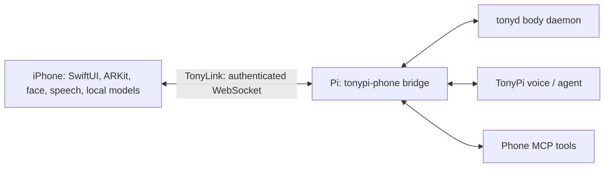

# iPeripheral

iPeripheral turns an iPhone into a companion peripheral for [TonyPi](https://github.com/markeljan/tonypi): its cameras, ARKit depth and LiDAR (on supported devices), screen face, microphone, motion sensors and on-device models connect to a bridge running beside the robot. Mounted and companion modes support different ways to observe Tony. This is experimental software; hardware capabilities vary by device and OS.



## Build

Install Xcode with an iOS simulator SDK, XcodeGen and (for the optional YOLO export) `uv`. From a clean clone:

```sh
xcodegen generate
xcodebuild -project iPeripheral.xcodeproj -scheme iPeripheral -sdk iphonesimulator -configuration Debug CODE_SIGNING_ALLOWED=NO build
```

The simulator builds without llama.cpp and uses a stub; camera, LiDAR and device inference require a physical iPhone. For a device build, run `scripts/fetch-vendor.sh` to download the pinned, SHA-256-checked llama.cpp device framework and attempt the optional YOLO26 export. This downloads substantial dependencies; consult their licenses first. Copy `App/Config/Local.example.xcconfig` to `App/Config/Local.xcconfig`, set your Apple development team and a unique bundle identifier, and run `scripts/build-and-install.sh`. Xcode must be signed in and the device trusted. The local configuration and downloaded models/frameworks are ignored by Git.

## Bridge and pairing

On the Pi, install the Python bridge with `uv sync --directory bridge` and configure the service using `deploy/install.sh` after reviewing its host and paths. See [protocol and pairing](docs/protocol.md): Bonjour discovers `_tonypi-phone._tcp`, the bridge announces a short-lived pairing code, and the phone stores its token in Keychain. Protect the local network and keep tokens and recordings private. The bridge can record camera frames and transcripts; obtain consent before recording people.

## Models and licenses

The framework is fetched from [llama.cpp](https://github.com/ggml-org/llama.cpp) (MIT); its license applies to the framework. LFM3 weights are downloaded separately under [Liquid AI's terms](https://huggingface.co/LiquidAI/LFM3-1.7B-GGUF). Optional YOLO26 export uses [Ultralytics terms](https://www.ultralytics.com/license), including AGPL-3.0 or a separate enterprise license. No model weights or framework binaries are committed. Review all upstream licenses before distribution.

See [PLAN.md](PLAN.md) for current capabilities and limitations. Project-authored code is MIT licensed; third-party components retain their own terms.
