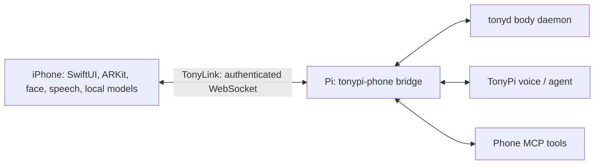

# iPeripheral

iPeripheral turns an iPhone into a companion peripheral for [TonyPi](https://github.com/markeljan/tonypi): its cameras, ARKit depth and LiDAR (on supported devices), screen face, microphone, motion sensors and on-device models connect to a bridge running beside the robot. Mounted and companion modes support different ways to observe Tony. This is experimental software; hardware capabilities vary by device and OS.



## Build

Install Xcode with an iOS simulator SDK, XcodeGen and (for the optional YOLO export) `uv`. From a clean clone:

```sh
xcodegen generate
xcodebuild -project iPeripheral.xcodeproj -scheme iPeripheral -sdk iphonesimulator -configuration Debug CODE_SIGNING_ALLOWED=NO build
```

The simulator builds without llama.cpp and uses a stub; camera, LiDAR and device inference require a physical iPhone. For a device build, run `scripts/fetch-vendor.sh` to download the pinned, SHA-256-checked llama.cpp device framework and attempt the optional YOLO26 export. This downloads substantial dependencies; consult their licenses first. Copy `App/Config/Local.example.xcconfig` to `App/Config/Local.xcconfig`, set your Apple development team and a unique bundle identifier, and run `scripts/build-and-install.sh`. Xcode must be signed in and the device trusted. The local configuration and downloaded models/frameworks are ignored by Git.

## Bridge and pairing

On the Pi, install the Python bridge with `uv sync --directory bridge` and configure the service using `deploy/install.sh` after reviewing its host and paths. See [protocol and pairing](docs/protocol.md): Bonjour discovers `_tonypi-phone._tcp`, the bridge announces a short-lived pairing code, and the phone stores its token in Keychain. Protect the local network and keep tokens and recordings private. The bridge can record camera frames and transcripts; obtain consent before recording people.

## Models and licenses

Reviewed 2026-10-31: `scripts/fetch-vendor.sh` fetches llama.cpp b11988 (MIT); preserve its notices when distributing the framework. `LocalModel.swift` downloads `LFM3-1.7B-QAD-Q4_0.gguf` and `LFM3-VL-2B-QAD-Q4_0.gguf` with `mmproj-LFM3-VL-2B-Q8_0.gguf` under [Liquid's text-model license](https://huggingface.co/LiquidAI/LFM3-1.7B-GGUF/blob/main/LICENSE) and [vision-model license](https://huggingface.co/LiquidAI/LFM3-VL-2B-GGUF/blob/main/LICENSE). Both are LFM Open License v1.0: accept its terms before use, including the US$10 million annual-revenue commercial-use threshold; redistribution requires the license, attribution/NOTICE where supplied and modification notices. llama.cpp's MIT license does not cover these weights.

`scripts/export-yolo.sh` actually exports **Ultralytics YOLO26n** (`yolo26n.pt`) into an ignored Core ML package that Xcode can bundle in the app. [Ultralytics applies AGPL-3.0 to its code and models, or offers a separate enterprise license](https://www.ultralytics.com/license). Exporting to Core ML does not remove those obligations. Before distributing an app containing YOLO, satisfy the applicable AGPL source/license obligations for the combined app or obtain suitable enterprise rights; an MIT-only app notice is insufficient. The exporter also installs [coremltools 8.3.0](https://github.com/apple/coremltools/blob/8.3/LICENSE.txt), [torch 2.5.1](https://github.com/pytorch/pytorch/blob/v2.5.1/LICENSE), [torchvision 0.20.1](https://github.com/pytorch/vision/blob/v0.20.1/LICENSE) and [NumPy <2](https://github.com/numpy/numpy/blob/v1.26.4/LICENSE.txt), which use BSD-style terms with their own notices (PyTorch includes additional third-party notices). Ultralytics and NumPy versions are not pinned by this script; recheck resolved dependencies for each build. No weights or framework binaries are committed or redistributed by this source repository. Keep downloaded artifacts private unless their distribution obligations have been met.

See [PLAN.md](PLAN.md) for current capabilities and limitations. Project-authored code is MIT licensed; third-party components retain their own terms.
